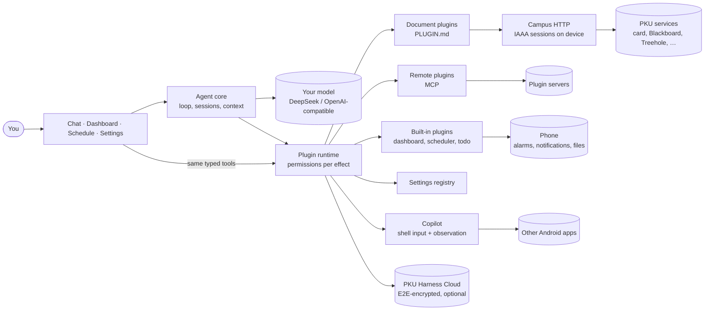

<div align="center">


# PKU Harness

**A pluggable, keyless, unified agent harness on your phone.**

An open-source, AI-native app for campus life at Peking University.

[](https://github.com/pkuinfo/pku-harness/actions/workflows/ci.yml)
[](https://github.com/pkuinfo/pku-harness/releases/latest)
[](https://github.com/pkuinfo/pku-harness/releases)
[](LICENSE)
[](https://docs.expo.dev/versions/v58.0.0/)
[](https://harness.novadiffusion.com/en/download)
[](https://github.com/pkuinfo/pku-harness/discussions)

[Website](https://harness.novadiffusion.com/en) · [Download](https://harness.novadiffusion.com/en/download) · [Docs](https://harness.novadiffusion.com/en/docs) · [Marketplace](https://harness.novadiffusion.com/en/marketplace) · [Plugins](https://github.com/pkuinfo/pku-harness-plugins) · [Discussions](https://github.com/pkuinfo/pku-harness/discussions)

English · [简体中文](README.zh-CN.md)

</div>

<p align="center">
  
  
  
  
  
</p>

---

Sign in once with your PKU account and hand your timetable, campus card, network fee, Treehole,
courses, finance and room bookings to an AI assistant that runs on your phone.

The app itself is a **harness**: an agent loop, a design system and a set of host services. Every
capability comes from **plugins**, and built-in and community plugins are equal.

## Why

Campus life at PKU is spread over a dozen websites, each with its own login, layout and quirks.
PKU Harness puts one agent in front of all of them:

- **Pluggable.** Each campus service is a plugin: a readable `PLUGIN.md` document you can install
  from a link, share, review and write yourself. No app release needed to add a service.
- **Keyless.** Your campus password, authenticator secret and model key stay in the phone's
  secure storage. There is no account with us, and no server of ours sees your prompts.
- **Unified.** Chat, dashboard, schedule and settings are one system. Whatever you can do with a
  tap, the agent can do as a tool, and the other way round.

## Features

### Chat and agent

- Streaming answers that call plugin tools and render native UI inline: forms, pickers, cards,
  checkouts.
- Multiple sessions with automatic titles, `/` commands, queued messages, per-session models,
  automatic context compaction and a usage board with cache-hit statistics.
- **Bring your own model**: DeepSeek by default, or SiliconFlow, Alibaba Bailian or any
  OpenAI-compatible endpoint.
- **Reads your files**: images, PDF, Word, Excel, PowerPoint and audio attachments.
- **Voice dictation** with your own speech-to-text key (SiliconFlow or any OpenAI-compatible
  transcription endpoint). Recordings go straight to that service and are deleted afterwards.
- **One settings registry**: every setting, built in or declared by a plugin, is a typed entry
  that both the Settings screens and the agent read and write. Secrets stay UI-only.

### Dashboard

- Widgets the assistant builds and maintains for you from chat, with live data: campus card
  balance, network fee, canteen crowds, deadlines, and anything a plugin exposes.
- Rearrange and edit by hand or by asking.

### Schedule

- Timetable synced from the dean's office, to-dos and reminders.
- Free-form recurrence ("in 2 days", "every 3 days, 16 times") delivered on the minute by the
  system alarm clock.
- Scheduled checks the assistant sets up from chat, e.g. "every morning, warn me if my card
  balance is below ¥100".

### Copilot (phone control)

- An opt-in plugin that lets the agent operate other Android apps you allow, step by step, with a
  floating status panel you can pause or take over at any time.
- Touch and keys go through a display-owned shell-input helper; accessibility is used only to
  observe the screen and verify results. Screenshots are an optional vision fallback.
- Payments and other sensitive steps are handed back to you. See [docs/COPILOT.md](docs/COPILOT.md).

### Plugins and marketplace

- **Plugins as documents.** A plugin is a folder with a `PLUGIN.md`: YAML steps and safe
  expressions that the app interprets. No code runs, installs are links
  (`pkuharness://plugin?src=…`), and updates are data. See
  [docs/PLUGIN-LANGUAGE.md](docs/PLUGIN-LANGUAGE.md).
- Remote plugins over MCP, and bundled TypeScript plugins for host features, all behind one
  contract.
- A [marketplace](https://harness.novadiffusion.com/en/marketplace) that indexes plugin
  repositories on GitHub, with an access review before every install.
- Official plugins cover the campus card and payment code, network fee, Blackboard courses,
  grades, course selection and catalogue, Treehole, library, room booking, finance, classrooms,
  canteens, shuttles, notices and campus events.

### Privacy and safety

- **Permissions you can read.** Every tool declares its effect (read, change, money, public);
  you choose per plugin whether the assistant may act, must ask first, or never acts.
- **Credentials stay on the device.** Plugins get scoped campus sessions, never your password.
- **PKU Harness Cloud** is optional: an end-to-end-encrypted relay and store for features like
  sharing your campus-card payment code with a friend (spend cap and PIN included). It knows your
  device only by an anonymous key. See [docs/CLOUD.md](docs/CLOUD.md).
- **Signed updates.** JavaScript updates come over the air from our own server, signed; native
  releases ship as signed APKs built by GitHub Actions. See [docs/OTA.md](docs/OTA.md) and
  [docs/RELEASE.md](docs/RELEASE.md).

## Architecture



The full design is in [docs/ARCHITECTURE.md](docs/ARCHITECTURE.md).

## Quick start

### Use the app

Android 7.0 or later (arm64): **[harness.novadiffusion.com/download](https://harness.novadiffusion.com/en/download)**,
or the [latest GitHub release](https://github.com/pkuinfo/pku-harness/releases/latest). Every APK
is built by GitHub Actions from a tagged commit and signed with the same key; the release notes
list the APK and certificate fingerprints. iOS support is being prepared ([docs/IOS.md](docs/IOS.md)).

You need a PKU account and an API key for a model provider (DeepSeek, SiliconFlow, Alibaba
Bailian or any OpenAI-compatible service).

### Develop

Requirements: [Bun](https://bun.sh), JDK 17, the Android SDK and an emulator or device. Use bun
and bunx for everything; never npm, npx, yarn or pnpm.

```bash
git clone --recurse-submodules https://github.com/pkuinfo/pku-harness.git
cd pku-harness
git submodule update --init   # if you cloned without --recurse-submodules
bun install
bun run verify                # typecheck + lint + tests: exactly what CI runs
bun run android               # development build on an emulator or device
```

Afterwards, `bunx expo start --dev-client` starts Metro for the installed development build.
Other useful commands: `bun run check` (typecheck + lint), `bun test`, `bunx expo install <pkg>`
(SDK-compatible versions) and `bunx expo-doctor`.

#### Without campus network or a model key

- Dev-only deep links run tools and chat turns on a device:
  `pkuharness://dev?tool=scheduler.preview&input=<json>` and `pkuharness://dev?chat=<text>`
  (add `&actor=agent` to exercise the ask-first prompts).
- Point **Settings → AI provider → OpenAI-compatible** at any compatible server (a local mock
  works) to run the agent loop end to end.
- `plugins/examples/demo-canteen` is a runnable remote (MCP) plugin.
- If your machine runs a system proxy, start the Android emulator without inheriting
  `HTTP_PROXY`; campus services must be reached directly.

### Write a plugin

Connecting a new campus service rarely needs this repository. Write a `PLUGIN.md` in the
[plugins repository](https://github.com/pkuinfo/pku-harness-plugins), check it on your computer
with `bun run plugin validate|run|test <dir>`, and install it in the app from its link. Start with
the [plugin guide](https://harness.novadiffusion.com/en/docs) and the
[language reference](docs/PLUGIN-LANGUAGE.md).

## Documentation

| Topic | Document |
|---|---|
| Layers, plugin model, agent, storage | [ARCHITECTURE.md](docs/ARCHITECTURE.md) |
| Sessions, commands, composer, context, usage | [AGENT-HARNESS.md](docs/AGENT-HARNESS.md) |
| The plugin language (`PLUGIN.md`) | [PLUGIN-LANGUAGE.md](docs/PLUGIN-LANGUAGE.md) |
| Copilot phone control | [COPILOT.md](docs/COPILOT.md) |
| Cloud: protocol, relay, card sharing | [CLOUD.md](docs/CLOUD.md) |
| Design tokens, components, motion, review checklist | [DESIGN.md](docs/DESIGN.md) |
| Over-the-air updates and releases | [OTA.md](docs/OTA.md) · [RELEASE.md](docs/RELEASE.md) |
| iOS readiness | [IOS.md](docs/IOS.md) |
| Inspecting network traffic | [TRAFFIC-DEBUGGING.md](docs/TRAFFIC-DEBUGGING.md) |
| Roadmap and task status | [PLAN.md](docs/PLAN.md) |
| Code conventions (for people and AI coding agents) | [AGENTS.md](AGENTS.md) |
| User and developer docs (Chinese and English) | [harness.novadiffusion.com/docs](https://harness.novadiffusion.com/en/docs) |

### Repository layout

```
src/
  app/          routes (Expo Router): tabs, sheets, modal screens
  screens/      screen bodies: chat/, usage/, settings/, plugins/, welcome/
  components/   design-system components: Text, Button, Glass, OptionMenu, charts/, …
  core/
    agent/      agent loop, tools, providers, sessions, context, attachments
    campus/     IAAA sign-in, campus HTTP sessions, service adapters
    cloud/      device identity, provider, encrypted store and channels, consent
    phone/      Copilot host service (binds the phone-control module to agent runs)
    runtime/    plugin registry, permissions, document plugins, remote (MCP) plugins
    scheduler/  reminders, checks, exact alarms, background runs
    settings/   the settings registry shared by screens and the agent
    speech/     voice dictation
    commands/ usage/ notify/ dashboard/ timetable/ todo/ files/ store/
  theme/        design tokens (colour, type, spacing, radius, motion)
modules/        our own Expo native modules (campus-http, phone-control, sms-consent, …)
config-plugins/ Expo config plugins (release signing, debug user CAs)
plugins/        submodule: SDK, plugins, cloud protocol and reference server
server/updates/ static OTA update server (Caddy)
docs/           design and architecture documents
```

## Related repositories

| Repository | What it is |
|---|---|
| [pkuinfo/pku-harness](https://github.com/pkuinfo/pku-harness) | This app (Expo SDK 58, React Native 0.88, Android first) |
| [pkuinfo/pku-harness-plugins](https://github.com/pkuinfo/pku-harness-plugins) | Plugin SDK, all plugins, the marketplace registry and the cloud server. **Start here to connect a campus service.** Included here as the `plugins/` submodule |
| [pkuinfo/pkuharness-website](https://github.com/pkuinfo/pkuharness-website) | The website: landing page, downloads, developer docs and plugin marketplace |
| [pkuinfo/pkucli](https://github.com/pkuinfo/pkucli) | Reference implementations of PKU service protocols (Rust CLI) |

## Contributing

Issues and pull requests are welcome. Please read [CONTRIBUTING.md](CONTRIBUTING.md) first. New
campus services usually belong in the [plugins repository](https://github.com/pkuinfo/pku-harness-plugins).
Look for issues labelled
[`good first issue`](https://github.com/pkuinfo/pku-harness/labels/good%20first%20issue) or
[`help wanted`](https://github.com/pkuinfo/pku-harness/labels/help%20wanted) to get started.

## Community

- Questions, ideas and show-and-tell: [GitHub Discussions](https://github.com/pkuinfo/pku-harness/discussions)
- Bugs and feature requests: [issues](https://github.com/pkuinfo/pku-harness/issues/new/choose)
- Where to ask what: [SUPPORT.md](SUPPORT.md)
- Everyone taking part agrees to the [Code of Conduct](CODE_OF_CONDUCT.md).

## Security

Please report vulnerabilities privately as described in [SECURITY.md](SECURITY.md), not in public
issues.

## License

[MIT](LICENSE), except for third-party components carrying their own license notices. PKU
Harness is a student project and is not affiliated with or endorsed by Peking University.

## Acknowledgments

Thanks to [DeepSeek Harness](https://github.com/deepseek-ai/deepseek-harness) for the
"everything is a plugin" architecture this app is modelled on, and to
[pkucli](https://github.com/pkuinfo/pkucli) for the campus protocols.

Thanks to [Mobile Next mobile-mcp](https://github.com/mobile-next/mobile-mcp) and
[mobilecli](https://github.com/mobile-next/mobilecli) for the reference architecture separating
shell-backed pointer/key input from UI observation. Harness implements this through its own
display-owned helper; neither project is a runtime dependency.

Thanks to [Mika](https://github.com/wangzan101/Mika) and its contributors for their work on
Android phone interaction. Copilot reuses and adapts portions of that work within
Harness-owned native modules and plugin interfaces, with an independent session engine.
Copilot does not import or call Mika project modules, plugins, or packages, and requires no
separate Mika installation or service. Adapted source retains its
[Apache-2.0 license](modules/phone-control/LICENSE) and [attribution](modules/phone-control/NOTICE).

Thanks also to [DSH Go](https://github.com/ccch1mneyyy/dsh-go) for design references on phone-task
lifecycle and recovery. Copilot's corresponding state handling is independently implemented;
DSH Go is not a dependency.

Copilot uses a Harness-owned accessibility entry point with the TalkBack service class name
for WeChat compatibility ([reported workaround](https://www.cnblogs.com/venblog/p/18794934)).
It does not contain Google's TalkBack implementation or change Harness's application identity.
Compatibility varies by WeChat/device version. Existing installs may need the connected phone
helper to re-enable Copilot after upgrading to the new service component.
