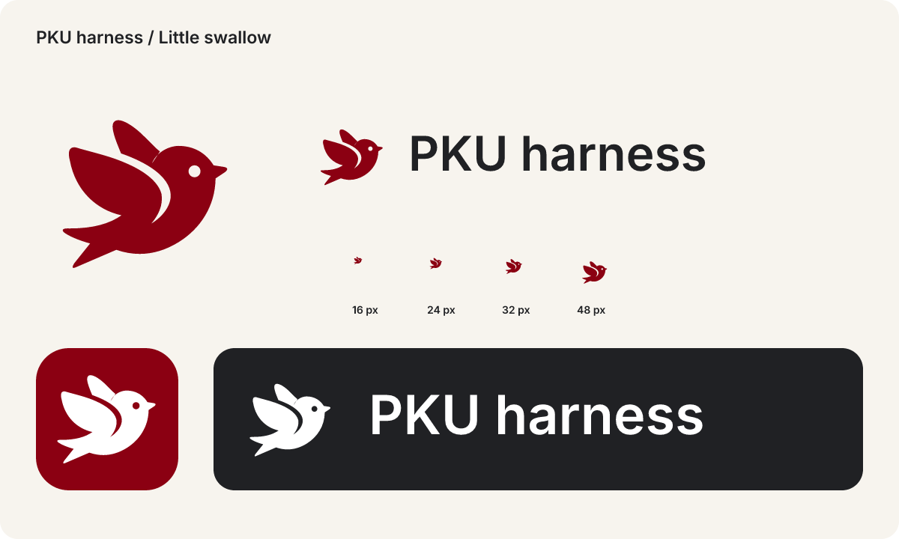

# PKU harness 标识系统 · Brand identity

> 2026-11-11 定稿方向：用户选定的「小燕」版本。替代旧 P / 轨道标志。
> 品牌图形与文字组合统一使用 **PKU harness**：PKU 大写、harness 小写。



## 形象与含义

小燕是轻快、亲切的校园搭档。短翼、饱满的身体、侧脸和叉尾共同表达行动与陪伴；
燕子也自然呼应燕园。P 仅作为结构中的轻微联想，不要求读者从图形中辨认字母，
不得为了突出 P 改变这版已经确认的轮廓。

The little swallow is a helpful campus companion. The approved silhouette takes priority over
forcing a hidden initial. This is a student project's identity, not an official university emblem.

## 唯一源文件

- `src/theme/brand.ts`：120 × 120 坐标系中的轮廓、眼睛镂空、品牌颜色和导出函数。
- `src/components/logo.tsx`：Skia 直接使用同一路径，采用 even-odd 填充；眼睛是真实镂空。
- `scripts/render-icons.ts`：Android 普通、自适应、单色、启动页和 favicon PNG。
- `scripts/render-brand.ts`：独立图形、横版与上下组合、规范预览、iOS Icon Composer 图层。
- `scripts/render-readme.ts`：使用同一标志重新生成深浅色 README 首屏。

批准的生成式参考图保存在 `design/brand-proposals/pku-harness-swallow-02.png`。
生产资产由人工重建的矢量曲线生成，已去掉参考图中的纹理、色差和各处不一致的细节。
后续修改只改源路径并重新生成，不在各个仓库单独描画。

## 版本与用途

| 资产 | 用途 |
|---|---|
| `assets/brand/mark-red.svg` | 浅底上的独立标志 |
| `assets/brand/mark-white.svg` | 深底与品牌红底上的反白标志 |
| `assets/brand/mark-black.svg` | 单色印刷和中性界面 |
| `assets/brand/lockup-{red,white,black}.svg` | 官网导航、GitHub 与文档的横版组合 |
| `assets/brand/stacked-{red,white,black}.svg` | 海报、封面与窄版空间的上下组合 |
| `assets/brand/icon.svg` | 社区头像与应用图标参考；Android 使用专门的自适应图层 |

每个 SVG 同时提供 PNG。横版和上下组合中的字标使用 Inter SemiBold 并导出为路径，
保证 GitHub、浏览器和绘图软件中的字距与外观一致，不依赖访问者安装字体。

## 色彩与排版

| Token | 值 | 用途 |
|---|---|---|
| Primary | `#8B0012` | 品牌红、浅底标志 |
| White | `#FFFFFF` | 深底反白标志 |
| Ivory | `#F7F4EE` | 展示底色 |
| Charcoal | `#202124` | 中性字标、深底展示 |

标志使用纯色，不添加渐变、投影、描边、立体效果或单独的眼睛颜色。
图形与字标间距使用导出资产中的固定比例，不手动拉伸或重新拼字。

- 标志周围至少保留图形可见高度的 1/4 作为安全区；导出的画布已含基础留白。
- 独立标志建议至少 24 CSS px；16 px 只用于 favicon 等受限位置。
- 横版组合建议至少 180 CSS px 宽；空间不足时使用独立标志。
- 保持原始纵横比，不翻转飞行方向，不更换眼睛与翼部留白。
- 浅底用红色或黑色，深底用白色；不将暗红标志直接放在炭黑底上。
- Android 自适应前景与单色图层有额外安全区，背景为满幅纯色，交给系统裁切。

## 动效与界面

静止时不循环运动。`Logo` 的 `intro` 采用短淡入，现有 `orbiting` 属性保留兼容性，
但改为轻微透明度呼吸，不再出现绕 P 旋转的小球。系统减少动态效果开启时保持静止。
`AgentOrbit` 是独立的工作状态指示器，不再作为品牌标志；不因换标志而改变任务状态逻辑。
欢迎页的抽象场景属于插画，并非旧 P 标志，不改变其交互功能。

## 生成与同步

在应用仓库运行：

```bash
bun scripts/render-icons.ts
bun scripts/render-brand.ts
bun scripts/render-readme.ts
```

需要更新同级官网与组织资料仓库时，显式运行：

```bash
bun scripts/render-brand.ts --sync-related
```

该命令只写本地资源文件，不提交、不推送、不部署。网站从 `public/brand` 引用生成的 SVG；
组织资料仓库更新头像与两张首屏横幅。历史真实截图保留原样，不伪造已安装新版的界面。
原生启动图标需在以后重新构建应用后生效；本次修改不安装或发布新版 APK。

## 验证边界

需检查红色、反白、单色、16/24/32/48 px、横版/上下版，以及圆形自适应裁切。
检查资源引用、重复生成的一致性，并运行应用与官网代码检查。
iOS Icon Composer 资产在 Linux 上生成，但需在 macOS 构建时验证系统最终渲染。
