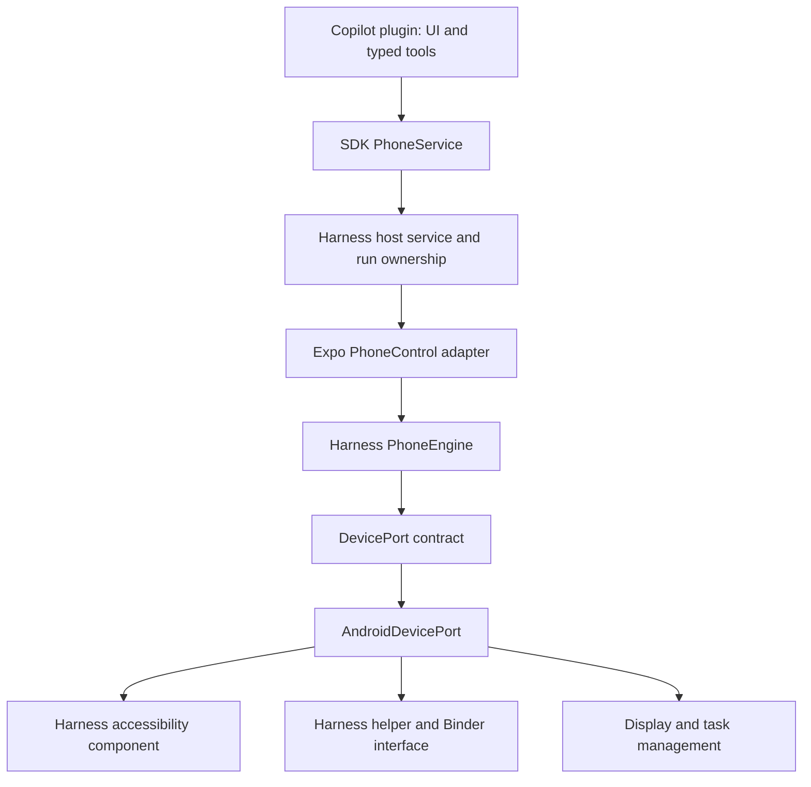

# Copilot mode

Copilot is a normal Harness plugin backed by a Harness-owned Expo native module. The user's
architecture requirement permits source reuse from Mika, with acknowledgment, but forbids
calling Mika project modules, plugins, or packages. This implementation adapts reusable
Android mechanisms into our own packages and runs them behind our own session engine and
platform contract. It does not require the Mika app, checkout, service, or database.

## Architecture

- `plugins/plugins/copilot` owns the setup/session screen, `/copilot` command, tool definitions,
  instructions, and settings contribution. It uses the SDK, React, and React Native.
- `plugins/packages/sdk/src/phone.ts` defines the host capability without native implementation
  types. `src/core/phone` binds it to the Expo module and assigns a session to one agent run.
- `modules/phone-control/android/src/main/java/org/pkuinfo/harness/phone/core` owns session
  scope, observation identities, fresh-screen checks, concrete action assessments, cancellation,
  handoff, and cleanup. It has no Android, Expo, or implementation-package imports.
- `DevicePort` and `DeviceSession` define the platform boundary. `AndroidDevicePort` translates
  between those contracts and the internal Android mechanisms. Adapted source is kept inside
  Harness-owned `platform`, `helper`, `connection`, `transport`, `policy`, and `ipc` packages.
- The Expo bridge translates typed operations and results. The generated `android/` project
  is not edited by hand; native declarations and helper keep rules live in the local module.
- Existing Harness storage remains the host storage service. Native pairing credentials stay
  inside this app's private storage and Android keystore. No Mika storage or database is read.

This is not a claim that every Android mechanism was written from scratch. Reused source
retains its origin and license headers. The architecture, exported contracts, session rules,
package ownership, and integration are Harness-owned.

## Session behavior

Use `/copilot` or plugin settings. Keep Android's wireless-pairing dialog open in split screen
while entering its port and code. Connection discovery has an optional manual port fallback.
The screen displays translated connection states and recovery hints. Select allowed apps and
start a session, then describe the task in chat.

The agent obtains the session ID and selected app packages from `status`. Observations issue
fresh snapshot IDs and element references. Actions must match the current snapshot and a fresh
screen. An uncertain dispatch consumes the old reference and is not retried by the session
engine. Unknown or unselected app windows stop automated operations. Passwords, protected
screens, and payment confirmation require user handoff.

The local preview refreshes while Harness is active. It is not saved to disk or returned by
model tools, and polling stops when the Copilot screen loses focus. Handoff moves the app to the user's screen. Normal completion of that reply
releases run ownership while retaining the handed-over session; the user can return control
and send a new message. Cancellation closes the session even during handoff. Ordinary
completion, error, and step exhaustion close a session that has not been handed over.

Stop immediately invalidates the session, then serializes cleanup after an in-flight action.
Cleanup preserves ordinary app tasks where the Android mechanism supports it, restores the
clipboard, releases the display, and stops the foreground service. Helper or accessibility
loss also requests cleanup. A stale stop request cannot close a newer session.

The plugin requests 40 model steps through the shared `maxAgentSteps` contract (default 10,
host maximum 60). Only a plugin actually used in a run can extend that run's allowance.
Scheduled tasks cannot access Copilot sessions.

## Attribution and platform references

### Reference review (2026-11-08)

The cloned DSH Go revision `9be93dd9` was reviewed alongside Mika revision `9fbbc89e`:

- DSH Go's `phone/PhoneTasks.kt` separates task identity, pause, in-flight calls, and stop.
  Harness retains its own session IDs and run leases; stopped sessions cannot be silently
  restarted by a model retry, and deliberate handoff survives normal reply completion.
- DSH Go's `phone/background/BackgroundGateState.kt` rejects results from superseded probes.
  Copilot now independently versions screen reads: delayed status/preview results cannot
  replace a newer stop, handoff, refresh, or navigation state. Polling pauses during user actions.
- DSH Go's `phone/PhoneTaskReturn.kt` distinguishes requesting a return from actually being
  visible. This remains a device-verification requirement for Harness handoff/resume, not an
  assumption inferred from a successful Android call.
- Mika's `core/action/ActionOutcome.kt` and `core/agent/OutcomeJudge.kt` distinguish dispatch,
  observed effects, and task completion. Copilot's tool instructions now explicitly require
  observed evidence, forbid blind retries of uncertain submissions, and call for handoff when
  repeated observations make no progress. This is guidance, not an automatic success judge.

DSH Go is AGPL-3.0 licensed. This review uses its design ideas; no DSH Go source was copied
into Harness. Mika adaptations retain the module's existing source attribution and license.

The integration merges current app `master` (including the thinking display and release 1.0.3
configuration) and current plugin `main`. It does not tag or publish a new APK release.

Selected Android mechanisms were adapted from Mika revision `9fbbc89e`, under Apache-2.0.
The module's `LICENSE` and `NOTICE` retain attribution; the root README thanks Mika and its
contributors. No Mika application, agent loop, model client, browser, or Linux runtime is a
runtime dependency.

Official documentation consulted:

- https://docs.expo.dev/versions/v58.0.0/
- https://docs.expo.dev/modules/overview/
- https://docs.expo.dev/modules/module-api/
- https://docs.expo.dev/modules/android-lifecycle-listeners/
- https://developer.android.com/reference/android/accessibilityservice/AccessibilityService
- https://developer.android.com/reference/android/app/ActivityOptions
- https://developer.android.com/develop/background-work/services/fgs/restrictions-bg-start

## Verification and remaining work

- [x] Plugin UI/tools and SDK capability wired through a local Expo module.
- [x] Harness-owned engine and platform contract are connected to the Expo bridge.
- [x] Native source, manifest, AIDL, and keep rules contain no Mika package references.
- [x] Debug APK builds; DEX inspection finds the Harness engine and helper and no
  `com.wangzan101.mika` packages.
- [x] Fifteen native JVM tests pass: successful dispatch, stale-screen and approval rejection,
  app scope, secret/protected-screen handling, uncertain dispatch, cancellation, handoff,
  replacement-session isolation, failed setup cleanup, and action classification in English
  and Chinese, including generic confirmation on a payment screen.
- [x] Architecture regression tests enforce package independence and the pure core boundary.
- [x] Harness typecheck/lint and tests after the rewrite: 1,414 pass, 3 skipped, no failures.
- [x] Final debug/release builds and minified helper/package verification after the rewrite.
- [x] Approval permissions are rechecked after classification, after waiting, and before dispatch. Observed target
  labels/packages are now shown separately from tool arguments; cancellation removes queued
  requests, including while a preference is being saved. Invalid classification is rejected.
  Regression tests caught and fixed a missing snapshot ID in the native policy adapter.
- [ ] Device verification of pairing, helper startup, separate display, observation, actions,
  preview, handoff/resume, cancellation, and task-preserving cleanup.
- [ ] Background model execution and light/dark UI verification.

The rewritten architecture's release build passed. DEX/mapping inspection confirmed that the
Harness helper, accessibility entry point, handoff provider, and engine survive minification,
the feedback resource is packaged, and no Mika packages remain. Final debug/release builds
also passed with the approval permission rechecks and classification fix. Integration
behavior remains unproven until device testing.

The user subsequently authorized testing once the emulator was free. The release APK was
installed with `adb install -r` (no data reset), launched, and its Copilot setup screen inspected
through mobile-mcp. Android enabled the accessibility service, and the packaged helper started
through the generated USB/ADB script and connected to Harness. This does not verify wireless
pairing or the full agent action loop.

Mobile-mcp's default persistent `mobilecli.DeviceServer` suppressed Android accessibility
services during testing. Stopping that test daemon and using `MOBILEMCP_LEGACY_ROBOT=1`
restored Copilot's bound service. Legacy screenshots use device ID `emulator-5554`; prefer
screenshots over hierarchy dumps during active sessions so automation does not suppress the
service under test.

Visual inspection found app-selection checkboxes without visible names: the host checkbox's
`label` is an accessibility label only. Copilot now renders the app name and package beside each
checkbox. This correction still needs an updated device build and visual recheck.
