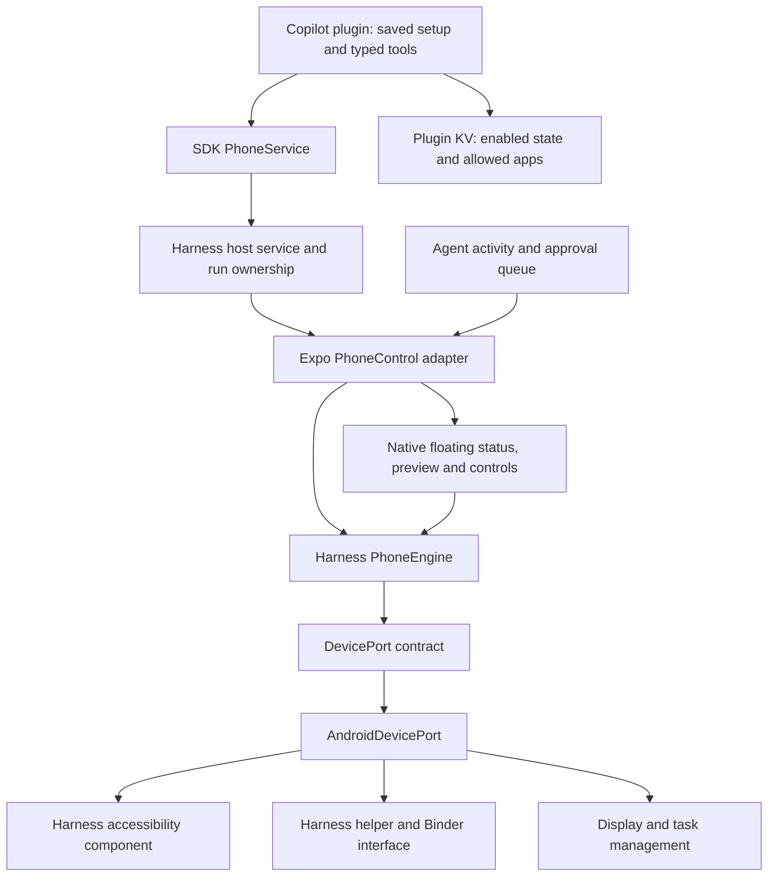

# Copilot mode

Copilot is a normal Harness plugin backed by a Harness-owned Expo native module. The user's
architecture requirement permits source reuse from Mika, with acknowledgment, but forbids
calling Mika project modules, plugins, or packages. This implementation adapts reusable
Android mechanisms into our own packages and runs them behind our own session engine and
platform contract. It does not require the Mika app, checkout, service, or database.

## Architecture

- `plugins/plugins/copilot` owns the setup/session screen, `/copilot` command, typed tools,
  instructions, settings contribution, and persisted enabled/app-selection preferences in its
  own KV store. The `configure` tool is user-only; the agent cannot change or widen this scope.
  The plugin uses the SDK, React, and React Native.
- `plugins/packages/sdk/src/phone.ts` defines the host capability without native implementation
  types. `src/core/phone` binds it to the Expo module and assigns a session to one agent run.
- `modules/phone-control/android/src/main/java/org/pkuinfo/harness/phone/core` owns session
  scope, observation identities, fresh-screen checks, concrete action assessments, cancellation,
  pause/resume, handoff, and cleanup. It has no Android, Expo, or implementation-package imports.
- `DevicePort` and `DeviceSession` define the platform boundary. `AndroidDevicePort` translates
  between those contracts and the internal Android mechanisms. Adapted source is kept inside
  Harness-owned `platform`, `helper`, `connection`, `transport`, `policy`, and `ipc` packages.
- The Expo bridge translates typed operations and results. The generated `android/` project
  is not edited by hand; native declarations and helper keep rules live in the local module.
- `CopilotService` owns the native session lifetime and default accessibility-overlay controls.
  Host adapters mirror current agent activity and pending Copilot approvals into that overlay;
  answers are matched to both the current session and approval ID. These controls are
  Harness-owned and do not invoke a Mika overlay or plugin.
- Existing Harness storage remains the host storage service. Native pairing credentials stay
  inside this app's private storage and Android keystore. No Mika storage or database is read.

This is not a claim that every Android mechanism was written from scratch. Reused source
retains its origin and license headers. The architecture, exported contracts, session rules,
package ownership, and integration are Harness-owned.

## Session behavior

Use `/copilot` or Settings → Plugins → Copilot for one-time setup. Until Copilot is ready the
screen is a numbered checklist derived from live readiness (`plugins/plugins/copilot/src/setup.ts`):

1. **Notifications** (recommended): the pairing code is typed into a notification during setup,
   and the ongoing task notification carries Stop. The helper button below asks for it inline
   while it's undecided; denied notifications only move the code entry onto the screen.
2. **Phone helper.** One button, *Turn on Wireless debugging*: it asks for notifications if
   needed, starts following the pairing (`startPairing`: mDNS search for Settings' pairing
   dialog + a high-importance notification with a RemoteInput *Enter code* box), and opens
   Developer options at Wireless debugging (About phone at Build number while Developer options
   are off). In Settings the user turns on Wireless debugging, taps *Pair device with pairing
   code*, then types the six digits into the notification. No port, no split screen: the port
   comes from discovery. The notification shows progress (pairing, connected, or the reason to
   re-enter a code). A collapsed *Enter code manually* fallback takes the code plus an optional
   `IP:port`. A previously paired phone gets the Reconnect form instead.
3. **Accessibility service**: automatic. When the helper reaches Running it applies, once each
   (`HelperRecovery`, from Mika's `BuiltinShellRecovery`): `appops … ACCESS_RESTRICTED_SETTINGS
   allow` (Android 13+), `pm grant … WRITE_SECURE_SETTINGS`, `cmd deviceidle whitelist +pkg`,
   and adds Copilot to `enabled_accessibility_services`. Notifications are never granted this way:
   a deliberate "Don't allow" stays. The row shows *Turning on…* meanwhile. A service still enabled but unbound is
   re-bound (`AccessibilityRepair`); one the user removed in Settings is left off and the row
   offers a one-tap *Turn on* through the helper. Without a helper, accessibility settings and
   App info remain as a fallback.
4. **Allowed apps**: scrolls to the app list. Never selected automatically.
5. **Turn on Copilot.** Never turned on automatically.

With `WRITE_SECURE_SETTINGS` held, the helper watchdog turns Wireless debugging back on by
itself when it needs to reconnect (`WirelessDebuggingAutoOn`; stops on networks that refuse it).
*Disconnect* revokes what the helper granted (`RecoveryPermissions.revokeAll`) before unpairing.
The helper still connects only to this phone (`AdbHosts` rejects non-local targets).

From a fresh install the user's actions are: tap *Turn on Wireless debugging*, tap *Allow*
(notification prompt), turn on Wireless debugging, tap *Pair device with pairing code*, tap
*Enter code* in the notification and type the code, then back in Harness choose apps and turn
Copilot on. Turning on Developer options (seven taps on Build number) is extra when they're off.

Each row states why it is needed and its live status; the first unfinished required step is
expanded. Every requirement is re-read when Harness returns to the foreground and once a second
while the screen is visible. Finishing setup on this screen shows a one-time "Copilot is ready"
confirmation; afterwards the checklist collapses into a Permissions row. The agent's `status`
tool returns `setupMissing`, and `start` refuses with the missing steps, so chat points the user
to `/copilot`.

Select allowed apps using their installed Android icons, names, and native switches. App
choices save immediately. Enable Copilot once, then describe jobs in chat without manually
starting a new session for each job. Turning Copilot off stops the current phone session while
retaining app choices. Changing scope closes any active session before the new scope is used;
configuration changes and session creation are serialized.

System UI (`com.android.systemui`) and Settings search
(`com.google.android.settings.intelligence`) are explicit companion choices when installed.
They may show controls opened by another app without exposing their own launcher activities.
The UI labels these entries as system dialogs; selecting Settings does not silently authorize
its companion packages. The agent must not try to launch a nonlaunchable companion directly.

The agent calls `status` for readiness, saved scope, and any active session. When enabled but
idle, `start` creates a lazy native session from only the saved packages. This setup operation
does not launch, read, or operate an app. It makes the floating controls available before the
first app-operation approval. Actual launch, input, submission, and other effects retain the
user's existing approval modes. No agent-supplied package list is accepted by `start`.

Floating controls are the default during a phone session. The user can stay in another app on
the main display while Copilot operates selected apps on its separate display. The collapsed
control expands to show current agent activity, a local app preview, pause/resume, stop,
optional takeover/return, and pending approvals. The window does not take keyboard focus and
allows touches outside it to reach the underlying app. The foreground-app guard refuses to
move an app the user is currently using; concurrent work targets other selected apps.

The native panel uses Android Material-themed Views: a draggable title, collapse icon, and
native overflow menu for takeover/return and opening Harness. Pause/Resume and Stop remain directly
visible as icon-only actions with accessibility labels and native long-press tooltips. Only Allow once uses a filled accent button. The panel is 264dp
wide with a 192dp preview; its compact status control is 48dp tall. Controls retain at least
48dp touch targets, with ripples, accessibility labels, scalable text, and light/dark resource
colors. Content scrolls on short screens so the action row stays reachable. Native overlay
tokens live in `modules/phone-control/android/src/main/res/values/copilot_overlay_theme.xml`;
this accessibility-service window does not depend on the React UI lifecycle.

When Harness is in the background, its existing Copilot approval request is mirrored into the
floating panel with the observed target and relevant action details. Allow once or Deny answers
that same request; it does not change saved permission modes. When Harness is foregrounded,
the usual in-app approval sheet remains the approval surface. The in-app Copilot panel remains
available for preview and controls. Full background behavior still requires the E2E checks below.

Observations issue fresh snapshot IDs and element references. Actions must match the current
snapshot and a fresh screen. Sliders expose their observed range and support `setProgress`;
editable fields use a field-bound `submit` action. An uncertain dispatch consumes the old
reference and is not retried by the session engine. Unknown or unselected app windows block
operations. Reopening a selected app is permitted for recovery; an explicit restart can reset
an agent-owned app task when ordinary launch restores the blocked screen, but must not discard
unsaved user work. Passwords, protected screens, and payment confirmation require user handoff.
The user only pays: Copilot places the order itself, including the submit-order or pay-now tap
(a public action, asked like any other). Every tap on the payment sheet that opens (choosing
Alipay or WeChat Pay, the cashier, password or fingerprint) is MONEY and hands over
(`PhoneActionPolicy.assess`). Steps that follow only Copilot screen operations think at low
effort (`src/core/agent/step-reasoning.ts`); planning keeps the provider default.

Physical device brightness uses separate typed `readBrightness` and `setBrightness` operations.
The virtual display's Settings page can omit hardware brightness controls, so this capability
addresses Display 0 through the authenticated Harness helper without opening Settings or
handing over the user's screen. It accepts only a bounded percentage and optional adaptive
mode—not arbitrary setting names, commands, or display IDs. The session must be active,
unlocked, not handed over, and include Android Settings in its selected scope; pause gates
the operation and cancellation/Stop still apply. Companion packages are needed only when
interacting with their UI, not for this typed brightness path.

Percentages use the AOSP SettingsLib perceptual gamma conversion with the physical display's
reported minimum/maximum bounds. They are not raw `screen_brightness / 255`. Omitted adaptive
mode preserves the current mode; an explicit value changes it. The helper writes once, then
polls readback briefly without repeating the mutation. It returns before/after state and a
verification flag. The model must check readback before claiming success; a separate read can
verify the state again, and adaptive mode may subsequently change the level. An uncertain result does not authorize a blind repeat write.

Preview images stay local: they are not saved by the feature or returned in model tool results.
The one exception is the opt-in vision fallback below.

### Vision fallback (opt-in screenshots, 2026-11-10)

WeChat (com.tencent.mm ≥ 8.0.5x) blanks or scrambles its accessibility tree for accessibility
services it does not recognise, so `observe` returns no usable elements. Copilot does not
impersonate TalkBack/Select to Speak, and there are no on-device models (ML Kit was removed;
`readVisibleText()` returns null). Instead the chat model looks at the screen:

- **Opt-in, off by default.** /copilot has a switch “Let the AI see screenshots” (「允许 AI 查看截图」),
  stored in the plugin's KV (`vision-preferences`), changed only by the user (`setScreenshots` is
  `userOnly`). Screenshots are of the app Copilot is operating on its own display, never the
  user's screen, and are sent to the user's AI provider.
- **`look`** (read, untrusted): `PhoneEngine.look` publishes a normal observation and captures
  the same downscaled frame as the preview (≤ 720 px long side, JPEG). Unlike the preview it is
  strict: a protected (FLAG_SECURE) or user-attention screen is refused before capture, other
  apps on the display fail the scope check, and a capture during which the screen became
  protected or the windows changed is discarded. The tool refuses unless the switch is on, the
  call is an agent call in a chat reply, and the reply's model lists `image` in its catalog
  `inputModalities` (`TurnInfo.acceptsImages`); otherwise it returns a message the agent relays
  (turn screenshots on in /copilot, or switch to e.g. DeepSeek-V4.1-Flash).
- **How the image reaches the model.** OpenAI-compatible Chat Completions accept no images in
  `role: "tool"` messages, and `@ai-sdk/openai-compatible` would stringify the base64 into the tool
  text. The plugin returns `withModelImage(result, image)` (SDK); the host's tool wrapper
  (`src/core/agent/tools.ts`) takes the image off before the result is shown or stored and
  queues it in a per-request `ToolImages` (`src/core/agent/tool-images.ts`). The run's
  `prepareStep` appends it as a user-role message `[note, image]` right after that step's tool
  results. Only the model call immediately after `look` carries it; on later calls it becomes a
  text stub. `step.response.messages` (saved as history) never contains prepareStep additions, so
  screenshots are never persisted in chat history, the UI tool part, or usage records. Remote
  plugins and scheduled runs cannot pass images (dropped, error returned).
- **`tapAt` / `typeAt`** take the `look` result's `snapshotId` and x/y in screenshot pixels
  (origin top-left) plus `target`, the model's words for what it is tapping. The engine requires
  the latest screenshot's snapshot, bounds-checks the point, maps the pixel centre to display
  pixels, and re-reads the screen: windows and every element's identity, position and state must
  match (text and slider values may change, so a ticking clock does not block). A point over a
  password field is refused; `ActionPolicy.assessPoint` judges an element the tree does show under
  the point like a tap on it, a payment sheet anywhere on screen makes it MONEY (refused, handoff),
  and otherwise it is WRITE. Both tools set `ToolDef.alwaysAsk`: every agent call shows the
  approval prompt (no “always allow”) with the AI-stated target, the point and the app, whatever
  the plugin's modes; scheduled calls are refused. `typeAt` uses the driver's tap-then-paste path
  (`typeAt`), whose verification is UNKNOWN without on-device OCR, so the agent looks again.
  `scroll` and `back` also accept a look's snapshotId.
- **Agent instructions:** try `observe` first; use the fallback only when it shows no or very few
  usable elements for an allowed app; never use coordinates when an element is available; never
  for payments or passwords; mention once that WeChat's terms forbid automation and Tencent may
  restrict accounts.
- Native changes (engine, Expo `assessAt`, `look`/`tapAt`/`typeAt` operations) need a new APK; an
  older APK reached by OTA answers with “update PKU harness”.
The native preview polls only when expanded and appropriate for the current session state;
the in-app preview polls only while its screen is focused and Harness is active. Handoff moves
the task to the user's screen only when explicitly requested or needed for a manual step.
Normal completion releases run ownership while retaining a deliberately handed-over or paused
session. The user can return control and send another message. Ordinary completion, error, and
step exhaustion close a session that is neither handed over nor paused. Cancellation closes it
in either state.

Stop invalidates the session immediately, then serializes cleanup after an in-flight action.
The current agent run cannot silently start a replacement after the user stops it. Cleanup
preserves ordinary app tasks where the Android mechanism supports it, restores the clipboard,
releases the display, and stops the foreground service. Helper loss also requests cleanup.
Accessibility is checked before every call and whenever Android drops the service mid-task
(switched off in Settings or stopped by the system): Copilot turns it back on (its own
WRITE_SECURE_SETTINGS grant, else the helper) and goes on; only when that fails does the call
end with `ACCESSIBILITY_OFF`, which tells the user to turn it on, and the session stops. It is
never reported as a protected screen. A stale stop request cannot close a newer session.

WeChat (8.0.80 checked) has a server-controlled anti-automation module (`AccExptService`,
config from `getMulitExpt`). When it counts an enabled accessibility service as hostile (not on
the server's `whiteServiceList`, not a white user, or `isForceStrike`; a real screen reader with
touch exploration on is exempt), it hides its node tree, intercepts accessibility actions and
injected touches by a server-set percentage, and sets FLAG_SECURE on the screens in
`disableScreenshotUIList` (screenshots go black, its Recents card is blank). Copilot's
TalkBack class name passed the whitelist until the server config changed (2026-11-11). Copilot
does not try to get around it (no fake touch exploration): it tells the user WeChat is blocking
automation and stops, since WeChat counts strikes against the account.

Chat turns have no step limit, so a Copilot task runs until it is done or stopped; long tasks
are compacted mid-turn as the context fills (AGENT-HARNESS.md §5.6). Scheduled tasks cannot access Copilot sessions.

## Attribution and platform references

### Reference review (2026-11-08)

The cloned DSH Go revision `9be93dd9` was reviewed alongside Mika revision `9fbbc89e`:

- DSH Go's `phone/PhoneTasks.kt` separates task identity, pause, in-flight calls, and stop.
  Harness retains its own session IDs and run leases; stopped sessions cannot be silently
  restarted by a model retry, and deliberate handoff survives normal reply completion.
- DSH Go's `phone/background/BackgroundGateState.kt` rejects results from superseded probes.
  Copilot now independently versions screen reads: delayed status/preview results cannot
  replace a newer stop, handoff, refresh, or navigation state. Polling pauses during user actions.
- DSH Go's `phone/PhoneTaskReturn.kt` distinguishes requesting a return from actually being
  visible. This remains a device-verification requirement for Harness handoff/resume, not an
  assumption inferred from a successful Android call.
- Mika's `core/action/ActionOutcome.kt` and `core/agent/OutcomeJudge.kt` distinguish dispatch,
  observed effects, and task completion. Copilot's tool instructions now explicitly require
  observed evidence, forbid blind retries of uncertain submissions, and call for handoff when
  repeated observations make no progress. This is guidance, not an automatic success judge.

DSH Go is AGPL-3.0 licensed. This review uses its design ideas; no DSH Go source was copied
into Harness. Mika adaptations retain the module's existing source attribution and license.

The earlier integration merged app `master` (including the thinking display and release 1.0.3
configuration) and plugin `main`; the app default branch is now `main`. That integration did
not tag or publish a new APK release.
Post-merge verification: app typecheck/lint and 1,630 tests passed (3 skipped); plugin
typecheck, registry/document validation, and 1,233 tests passed. Earlier native build evidence
below predates this merge. Current device evidence and remaining checks are recorded below.

Selected Android mechanisms were adapted from Mika revision `9fbbc89e`, under Apache-2.0.
The module's `LICENSE` and `NOTICE` retain attribution; the root README thanks Mika and its
contributors. No Mika application, agent loop, model client, browser, or Linux runtime is a
runtime dependency.

Official documentation consulted:

- https://docs.expo.dev/versions/v58.0.0/
- https://docs.expo.dev/modules/overview/
- https://docs.expo.dev/modules/module-api/
- https://docs.expo.dev/modules/android-lifecycle-listeners/
- https://developer.android.com/reference/android/accessibilityservice/AccessibilityService
- https://developer.android.com/reference/android/app/ActivityOptions
- https://developer.android.com/develop/background-work/services/fgs/restrictions-bg-start

## Verification and remaining work

Latest main verification: 1,658 passed, 3 skipped; plugin verification: 1,245 passed;
native JVM tests: 34 passed. Typecheck and lint passed in both repositories.
The requested emulator browser, brightness, floating-control, and concurrent-use cases passed;
wireless pairing and broader physical-device coverage remain unverified.

- [x] Plugin UI/tools and SDK capability wired through a local Expo module.
- [x] Harness-owned engine and platform contract are connected to the Expo bridge.
- [x] Native source, manifest, AIDL, and keep rules contain no Mika package references.
- [x] Debug APK builds; DEX inspection finds the Harness engine and helper and no
  `com.wangzan101.mika` packages.
- [x] The original fifteen native JVM tests passed: successful dispatch, stale-screen and approval rejection,
  app scope, secret/protected-screen handling, uncertain dispatch, cancellation, handoff,
  replacement-session isolation, failed setup cleanup, and action classification in English
  and Chinese, including generic confirmation on a payment screen.
- [x] Architecture regression tests enforce package independence and the pure core boundary.
- [x] Harness typecheck/lint and tests after the rewrite: 1,414 pass, 3 skipped, no failures.
- [x] Final debug/release builds and minified helper/package verification after the rewrite.
- [x] Approval permissions are rechecked after classification, after waiting, and before dispatch. Observed target
  labels/packages are now shown separately from tool arguments; cancellation removes queued
  requests, including while a preference is being saved. Invalid classification is rejected.
  Regression tests caught and fixed a missing snapshot ID in the native policy adapter.
- [x] Emulator helper startup through the packaged USB script and accessibility binding.
- [x] Original browser search/submit, explicit handoff, handback to preview, and clean stop.
- [x] Background observation of existing Chrome results while Clock remained on the main display.
- [x] Earlier switch-list UI inspected in light and dark themes.
- [x] Fresh background Chrome search from a model prompt, automatic start from saved scope,
  floating submission approval, pause → approve while paused → resume, live results preview,
  and completion cleanup while Clock remained usable on the main display.
- [x] Current app-icon picker inspected in light/dark themes with selections preserved.
- [x] Floating Stop while submission approval was pending canceled the native session and
  agent run, removed the approval, and left only Clock on Display 0.
- [x] A subsequent user message started a fresh session; denying a floating submission
  approval produced a tool rejection, truthful no-submission response, and clean end.
- [x] Typed physical-display brightness change to 70%, independent agent readback, and
  Android Settings confirmation while Clock remained foreground.
- [x] Saved setup → automatic lazy start → task completion for the fresh browser search.
- [x] A subsequent brightness task automatically started from the saved scope without manual setup.
- [x] Native operation-status labels observed on device.
- [x] Compact Working/Review bubbles and expanded approval controls verified in light/dark themes.
- [x] Final release build installed; Pause → Stop during pending approval settles the tool
  card to the localized stopped error without an activity spinner. A fresh subsequent search
  auto-started, completed, verified results, and cleaned up while Clock stayed usable.
- [ ] Wireless pairing and broader cancellation/task-preservation coverage on device.

The rewritten architecture's release build passed. DEX/mapping inspection confirmed that the
Harness helper, accessibility entry point, handoff provider, and engine survive minification,
the feedback resource is packaged, and no Mika packages remain. Final debug/release builds
also passed with the approval permission rechecks and classification fix. Integration
coverage at that stage was limited to builds; the subsequent device evidence is below.

The user subsequently authorized testing once the emulator was free. The release APK was
installed with `adb install -r` (no data reset), launched, and its Copilot setup screen inspected
through mobile-mcp. Android enabled the accessibility service, and the packaged helper started
through the generated USB/ADB script and connected to Harness. This does not verify wireless
pairing or the full agent action loop.

Mobile-mcp's default persistent `mobilecli.DeviceServer` suppressed Android accessibility
services during testing. Stopping that test daemon and using `MOBILEMCP_LEGACY_ROBOT=1`
restored Copilot's bound service. Legacy screenshots use device ID `emulator-5554`; prefer
screenshots over hierarchy dumps during active sessions so automation does not suppress the
service under test.

The latest-main release (1.0.3, versionCode 4) was built and installed without clearing data.
The earlier app-selection UI used native switches in labeled grouped rows, with selected count
and a manual Start button above the list. The current implementation replaces that button with
persisted Enable Copilot setup and adds installed app icons. The earlier light/dark screenshots
and Chrome/Clock/Settings selection checks passed alongside native tests (15), plugin tests
(1,233), and app tests (1,630 passed, 3 skipped). These counts describe that earlier build.
The current icon picker was subsequently inspected in both themes and preserved its selections:
`/tmp/copilot-e2e-evidence/app-icons-current-light.png` and
`/tmp/copilot-e2e-evidence/app-icons-current-dark.png`.

The live model completed a Chrome search for Peking University after the field-bound editor
submit action was added. Google results and the official PKU website link were visible after
an explicitly requested handoff; returning control showed the same results in the preview.
The session then stopped cleanly. Evidence: `/tmp/copilot-e2e-evidence/browser-search-handoff.png`
and `/tmp/copilot-e2e-evidence/browser-handback-preview.png` on the development host.

An initial background trial read existing Chrome results while Clock remained on the main
display. A subsequent fresh test used the actual model prompt: “Use Copilot to search Chrome
for PKU library. Verify results. No handover.” The agent automatically started from saved app
scope, while Clock's stopwatch and lap controls remained usable on Display 0 and Chrome ran
on Display 8. The floating submission approval was opened, the session was paused, approval
was granted while paused, and the session was resumed. The live preview then showed Google
results for PKU library, including the official library result. Completion cleanup left Clock
in the foreground; no handover was requested or needed for this case.

Evidence on the development host:

- `/tmp/copilot-e2e-evidence/floating-search-approval.png`
- `/tmp/copilot-e2e-evidence/floating-paused.png`
- `/tmp/copilot-e2e-evidence/floating-search-preview.png`
- `/tmp/copilot-e2e-evidence/main-clock-after-search.png`

This verifies that fresh background browser flow, including its pause/approval/resume sequence.
It does not establish every app or cancellation case. Native operation status was subsequently
verified showing “Opening an app” and “Planning the next step / Last action: Scrolling the app”
with a Settings preview while Clock remained on the main display. Evidence is saved as
`/tmp/copilot-e2e-evidence/floating-native-opening-status.png` and
`/tmp/copilot-e2e-evidence/floating-native-planning-preview.png`. Compact Working/Review
bubble labels and expanded approval controls were subsequently verified in both themes.

The brightness UI attempts initially failed. The reader omitted the range control, Settings
search introduced an unselected package, and a subsequent run encountered an unselected
System UI window. Even with all three Settings-related packages selected, the virtual-display
Settings page reached Display & touch but exposed no hardware brightness slider. These failed
attempts were reported truthfully and motivated the typed physical-display capability above.

The subsequent brightness E2E passed using a fresh actual-model prompt: “Use Copilot to set
brightness to 70%. Verify it. No handover.” The agent automatically started from the saved
scope, read 82.8%, set 70%, made a separate read confirming 70%, and ended the session. Clock
remained on the main display with its stopwatch running. Independent ADB inspection showed
raw brightness changing from 102 to 53, with mode 0 (manual); an independent Android
`DISPLAY_SETTINGS` screen showed “Brightness level 70%”. The raw value differs from the
perceptual percentage by design. After recording evidence, the test restored the baseline
raw value 102 and manual mode 0.

Evidence on the development host:

- `/tmp/copilot-e2e-evidence/brightness-background-completed.png`
- `/tmp/copilot-e2e-evidence/brightness-agent-verification.png`
- `/tmp/copilot-e2e-evidence/brightness-70-system-settings.png`

A Stop test interrupted the session while a floating submission approval was pending. Native
cleanup and agent-run cancellation completed: the approval disappeared, only Display 0
remained with Clock foreground, and chat showed the stopped task with retry available. This
found a separate presentation bug: an old tool card could retain its activity spinner after
the run had stopped. The final release build includes the fix. Its installed-device smoke check passed:
a paused pending submission became a localized stopped tool error with no running-tool spinner.

Stop evidence on the development host:

- `/tmp/copilot-e2e-evidence/floating-stop-pending-dark.png`
- `/tmp/copilot-e2e-evidence/floating-stop-keeps-clock.png`
- `/tmp/copilot-e2e-evidence/floating-stop-agent-cancelled.png`

A subsequent new user message automatically started a fresh session. Denying the PKU museum
search submission from the floating controls produced a tool rejection. The assistant
truthfully reported that it had not submitted the search, then ended the session without
handover. This verifies denial handling and the ability to start again only on a new user
request after Stop. Compact Working/Review bubbles and expanded approval controls were
inspected in both light and dark themes.

Denial evidence on the development host:

- `/tmp/copilot-e2e-evidence/floating-deny-pending.png`
- `/tmp/copilot-e2e-evidence/floating-deny-agent-result.png`

The browser, brightness, Stop, and Deny cases have device evidence for simultaneous phone
use. On the final installed release, a fresh request after Stop automatically started a new
session, submitted the PKU library query through floating approval, verified Google results,
and ended without handover. Clock remained foreground; its stopwatch and Lap controls worked.
The final completion notification appeared over Clock, and only Display 0 remained after cleanup.
The final smoke run completed before a results-preview screenshot was captured; the earlier
live-preview evidence above covers that unchanged native preview implementation.

Final-build evidence:

- `/tmp/copilot-e2e-evidence/final-stop-no-spinner.png`
- `/tmp/copilot-e2e-evidence/final-paused-approval.png`
- `/tmp/copilot-e2e-evidence/final-fresh-search-approval.png`
- `/tmp/copilot-e2e-evidence/final-search-clock-completion.png`
- `/tmp/copilot-e2e-evidence/final-search-agent-result.png`

Final release: `:phone-control:testDebugUnitTest :app:assembleRelease`, x86_64, successful in
6m 7s; installed with `adb install -r`. APK SHA-256:
`096eb2c4f2a524979509aae75fa89d6184a3e6cc43b6d1ada896f54e901fedae`.
Build/test logs are `/tmp/copilot-final-release.log`, `/tmp/copilot-final-main-verify.log`,
and `/tmp/copilot-final-plugin-verify.log`. Brightness was restored to raw 102/manual mode,
and the test stopwatch reset. Saved Copilot configuration remains enabled.

These results establish the requested emulator experience, not universal app compatibility.
Wireless pairing, reboot recovery, and broader physical-device/OEM coverage remain unverified.

### Compact native panel verification (2026-11-08)

The subsequent UI-only release replaces the oversized filled controls with the native panel
specified above. `bun run verify` passed (1,658 tests, 3 skipped); native JVM tests passed
(34); release assembly succeeded in 3m 39s. Installed APK SHA-256:
`6bfa74ca5b985a71505974468dcc6faf98854d12180edcf6d3e1f3782a019666`.
Logs: `/tmp/copilot-compact-verify.log`, `/tmp/copilot-compact-release.log`.

On the installed release, the actual model searched Chrome for PKU library with Clock running.
The compact control expanded, the native overflow menu exposed takeover/Open Harness,
light-to-dark switching repainted the panel, Pause held the pending submission, Allow once
removed the approval without resuming, and Resume allowed completion without handover.
A subsequent Chrome preview test captured a real browser frame in the redesigned panel.
Only Display 0 remained after completion; Clock was then stopped/reset and system light mode
restored. No phone-engine or approval-policy behavior changed in this UI refinement.

Evidence: `/tmp/copilot-e2e-evidence/material-compact-light.png`,
`material-approval-light.png`, `material-approval-dark.png`, `material-menu-light.png`,
`material-paused-dark.png`, `material-search-agent-result.png`, and `material-preview-1.png`
in that same evidence directory. Large-font and physical-device layout coverage remains untested.

The icon-only follow-up release keeps the 48dp Pause/Resume and Stop targets in a small,
end-aligned toolbar. Approval choices retain text. On-device checks verified light/dark
appearance, pause → resume during pending approval, the native Stop tooltip on long press,
and Stop removing the session/overlay without submitting the query. Clock remained foreground.
Evidence in `/tmp/copilot-e2e-evidence/`: `icons-approval-light.png`, `icons-paused-dark.png`,
`icons-resumed-dark.png`, `icons-stop-tooltip.png`, `icons-stop-cleared.png`.
Checks: main 1,658 pass/3 skip, native 34 pass; release build succeeded in 1m 53s and installed.
Logs: `/tmp/copilot-icons-verify.log`, `/tmp/copilot-icons-release.log`. APK SHA-256:
`2a3571eec2b8e1c0c6fd2004b3a994732fbbcdc212753b1dc524ec4d755b00f9`.

### Copilot settings refinement (2026-11-08)

The plugin settings now lead with the enable switch, collapse connection details when ready,
and default to the saved allowed-app list. All/Allowed filters, smaller real app icons, search
with clear/empty state, and a header refresh replace the long setup-heavy page. Reconnect and
first-time pairing use separate modes. Active-task preview is opt-in, with compact icon controls.
Readiness labels distinguish enabled configuration from a disconnected helper.

Emulator checks covered enable off/on with the four-app scope retained, All/Allowed filters,
unmatched search and clear recovery, reconnect/pair form layouts, automatic readiness recovery,
light/dark appearance, and 130% font scaling with scrolling. Final release installed successfully;
normal font scale and light mode restored, helper connected, Copilot enabled. Wireless pairing
was inspected as a form only, not executed. Active-task controls were not re-exercised in this
settings-only pass; previous floating/task E2E evidence remains above.

Checks: main verification 1,658 pass/3 skip; plugin verification 1,245 pass; release build
succeeded in 1m 50s. Logs: `/tmp/copilot-settings-main-verify.log`,
`/tmp/copilot-settings-plugin-verify.log`, `/tmp/copilot-settings-final-release.log`.
APK SHA-256: `286757bae1d7eb9107835a1531ae77b1b4861c3f9c8ac19077793fab23b86282`.
Evidence in `/tmp/copilot-e2e-evidence/`: `settings-ready-light.png`, `settings-all-dark.png`,
`settings-ready-large-dark.png`, `settings-setup-large-dark.png`, `settings-pair.png`,
and `settings-empty-search.png`.

### Flat settings design (2026-11-08)

A further visual pass replaces the large heading, tinted background, grouped cards, and
segmented pills with a compact fixed toolbar, neutral canvas, flat compact app rows, and
underlined filter tabs. Native switches and all phone-control behavior are retained.
Optional shared host styles are documented in DESIGN.md; other screens keep their defaults.

Release installed and inspected in light/dark and at 130% text size. All/Allowed tab switching
passed, and the saved four-app scope remained intact. Normal font scale and light mode restored.
Main verification: 1,658 pass/3 skip; plugins: 1,245 pass. Build: successful in 1m 47s.
Logs: `/tmp/copilot-modern-main-verify.log`, `/tmp/copilot-modern-plugin-verify.log`,
`/tmp/copilot-modern-release.log`. APK SHA-256:
`b0372f0316005f8667771ec5601f100c11fee2663302ea5db43f51809e8e319b`.
Screenshots in `/tmp/copilot-e2e-evidence/`: `modern-settings-light.png`,
`modern-settings-dark.png`, `modern-settings-large-dark.png`.

### Alphabet quick access (2026-11-08)

All apps now has alphabetic sections and a fixed right-edge letter index. Only initials with
installed apps appear. Tapping scrolls to the section; near the end, scrolling clamps to the
list boundary so the chosen section is visible. The index hides during search and in Allowed
apps. Its own rail scrolls if necessary, and a reserved strip prevents overlapping controls.
Latin accents normalize to base letters; other scripts/symbols group under # and remain
searchable. No transliteration or drag-to-scrub behavior is claimed.

Verified C → S → C navigation, light/dark rendering, and retained four-app scope on the
emulator. Main verification: 1,660 pass/3 skip; plugins: 1,247 pass, including grouping,
accent, duplicate-name and non-Latin tests. Logs: `/tmp/copilot-index-main-verify.log`,
`/tmp/copilot-index-plugin-verify.log`, `/tmp/copilot-index-release.log`. Evidence:
`/tmp/copilot-e2e-evidence/index-jump-s-light.png`, `index-jump-c-dark.png`.

Final spacing correction built in 1m 12s and installed; verified reserved index space in
`/tmp/copilot-e2e-evidence/index-final-light.png`. APK SHA-256:
`92b69a65b431f622a5c84f80d5b7d0828ec47e2d5f2bfd2ffe02bdc432369a6d`.
